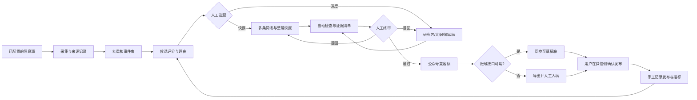
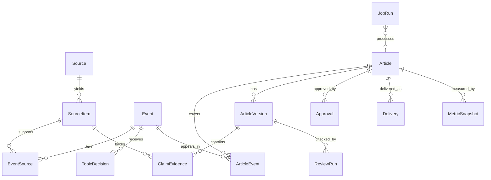
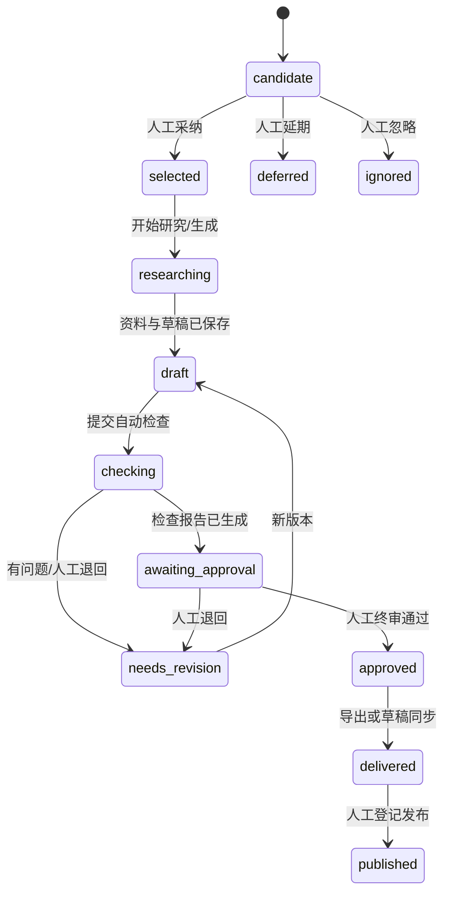
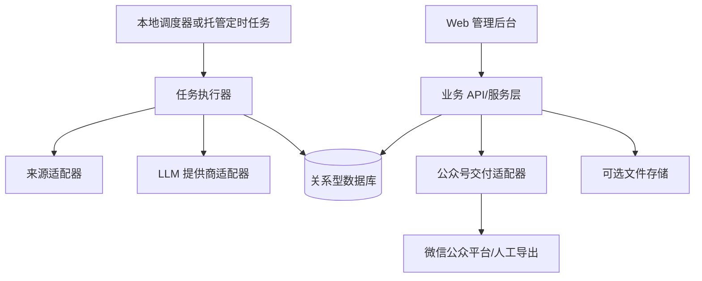

# 医智风向 AI 医疗资讯自动化平台产品需求文档（PRD V1.0）

> 状态：初稿，供产品与开发评审；日期：2026-10-23；目标实施者：个人开发者。本文是可调整的需求基线，不表示外部接口已经开通或系统已经实现。

## 0. 需求诊断与决策摘要

### 0.1 已有需求中的关键缺口与调整

| 事项 | 发现 | V1.0 处理建议 |
|---|---|---|
| 自动化边界 | 原设想从采集直达发布，医学内容误报的代价高 | 人工决定选题、确认关键事实、终审成稿；系统不得自行发布 |
| 事件与网页 | 同一事件可能有多篇报道、更新或更正 | 分开保存 `SourceItem`（来源记录）和 `Event`（报道事件）；一事多源，文章关联事件及引用证据 |
| 新闻源合法性 | 抓取权限、全文使用许可和反爬限制未知 | 先用许可清楚的 RSS/API/公开页面；逐源记录获取方式、条款、速率；不默认可复制全文 |
| 公众号接口 | 账号类型、认证、接口权限、图片素材和配额未知 | 首阶段做真实账号权限探针；MVP 必有可复制/导出的公众号兼容稿，API 草稿同步作为条件交付 |
| 深度稿复杂度 | 自动研究、交叉核验、迭代审稿易使首版膨胀 | 首版只支持单事件、固定研究包与大纲、一次生成和一次人工退回修改；复杂多轮研究放 P1 |
| “事实审校”定义 | LLM 不能证明医学事实，也无法替代专业审查 | 要求句级来源定位、自动风险提示和人工核对清单；高风险断言必须人工确认或删除 |
| 反馈闭环 | 运营接口和指标可得性未知，阅读量不足以代表质量 | 首版记录选题决策、生产耗时和手工导入指标；策略自动调整放 P1 |
| 独立 Agent | 多 Agent 协同增加调试、成本和状态复杂度 | 首版用确定性工作流与少量受约束的 LLM 步骤，不部署自治 Agent 团队 |

### 0.2 标记规则

- **[定] 已确定需求**：来自项目说明或为安全完成目标所必需。
- **[荐] 设计建议**：首版推荐方式，可在开发前替换，但需满足对应验收标准。
- **[假] 技术/运营假设**：尚未由真实环境证实；必须在相关阶段验证。
- **[待] 待确认问题**：见第 12 章，按影响排序。

各功能表中的“验收”定义外部行为；第 7 章的技术栈不构成业务需求。

## 1. 产品概述

### 1.1 背景、定位与用户

**[定]** 医智风向面向 AI × 医疗交叉领域公众号运营，支持资讯发现、事件整理、选题、快报/深度稿生产、审校、草稿交付和反馈记录。首版为单人编辑使用，未来允许扩展协作者和其他平台。

| 用户 | 核心任务 | 权限边界 |
|---|---|---|
| 主编/运营者（MVP 唯一角色） | 管理来源、选题、编辑、终审、交付与复盘 | 通过登录访问全部业务功能；所有终审动作留痕 |
| 未来协作者（P1） | 研究、撰稿或审核 | 按角色授权，首版不实现复杂 RBAC |

### 1.2 核心价值与成功标准

**[定]** 提高可信资讯覆盖和内容生产效率，同时保持每条关键事实可追溯、每篇稿件由人终审。系统不提供诊断或治疗建议，不将新闻解读写成医疗建议。

| 维度 | MVP 成功标准（试运行连续 2 周的建议门槛） | 获取方式 |
|---|---|---|
| 流程打通 | 每天至少一次采集→候选→人工选题→稿件→终审→可交付草稿完整演示 | 任务与审核日志 |
| 可追溯性 | 已批准稿件中，事实性关键断言均能定位至少一条来源及其访问时间；无来源断言不得通过终审 | 审校清单抽检 |
| 可用性 | 采集失败、LLM 失败、草稿同步失败均有可见状态和重试或手工处置方式 | 故障演练 |
| 效率 | 相比用户记录的手工基线，每期快报准备耗时下降；具体目标在基线测量后确定 | 编辑计时记录 |
| 质量 | 试运行的已发布内容无经确认的重大事实错误；发现错误能够追溯版本和来源 | 事后复盘 |

以上为试运行评价标准，不保证零错误；上线前由用户确定“关键断言”和“重大错误”的实际审核口径。

### 1.3 范围边界

**[定]** MVP 只处理公开、可合法访问的资料与公众号文章草稿。禁止自动发布、未经审核的医学建议、绕过付费或访问控制、未经许可批量转载全文。患者个人信息、临床病历、医疗影像不在范围内。首版不承诺实时全网覆盖、完整医学证据系统评价或法律合规保证。

## 2. 业务架构

**[定]** 一个共享事件库、快报和深度两条内容线、一个管理后台，以及轻量反馈记录。



**[定]** 一个事件可同时进入两条内容线，但必须提示相互关系：已有快报的事件可生成后续深度稿；同一事件同一内容类型重复发布时须显式确认。

## 3. 功能架构与优先级

优先级说明：P0 为可交付最小闭环；P0-C 为账号/API 条件满足后交付；P1 为下一阶段。优先级不等于立即开发顺序。

| 编号 | 模块/功能 | 输入 → 输出 | 优先级 | 验收摘要 |
|---|---|---|---|---|
| F01 | 新闻源配置 | 来源地址、类型、频率、许可备注 → 来源配置 | P0 | 可增停改查；非法地址或缺必要信息被拒绝 |
| F02 | 定时与按需采集 | 来源配置 → 来源记录/采集日志 | P0 | 同一来源重复采集不重复入库；失败可见并可重试 |
| F03 | 解析、规范化与事件聚合 | 来源记录 → 结构化事件及关联 | P0 | 同 URL 去重；相似事件给出合并建议，人工可拆分/合并 |
| F04 | 分类、来源级别与评分 | 事件/来源 → 标签、分数、理由 | P0 | 分项分数和证据在 UI 可见，可重新评分 |
| F05 | 选题池与人工决策 | 候选事件 → 采纳/忽略/延期/合并记录 | P0 | 决策原因与时间可追踪；已报道事件有提醒 |
| F06 | 快报稿 | 人工选中的多事件及可核实来源 → 简讯和整稿 | P0 | 每条回答“发生了什么/为何重要/来源”；草稿可编辑 |
| F07 | 轻量深度稿 | 单事件、研究包、角度 → 大纲和文章草稿 | P0 | 先保存资料包和大纲；人工可修改大纲；支持一次退回重写 |
| F08 | 自动检查 | 草稿与引用 → 风险/缺证据清单 | P0 | 无来源断言、高风险医学表述、失效链接被标记；检查结果不自动放行 |
| F09 | 编辑、终审、版本与排版 | 草稿 → 已批准的公众号兼容稿 | P0 | 终审必须显式操作；退回与修改生成新版本；可预览/导出 |
| F10 | 微信草稿同步 | 已批准稿、封面素材、账号凭据 → 微信草稿 ID/错误 | P0-C | 权限可用时同步成功且微信后台可见；失败不改变终审状态 |
| F11 | 发布与反馈登记 | 发布 URL、日期、手工指标 → 基础记录 | P0 | 可关联文章版本；不凭阅读量自动改分 |
| F12 | 精细看板、自动复盘、多 Agent、多平台、智能配图 | 历史内容和指标 → 洞察/更多交付 | P1 | 另写细化规格后实施 |

**依赖关系：** F01→F02→F03→F04→F05→F06/F07→F08→F09→F10/F11。F10 的验证应在首阶段提前进行，以免在末端发现账号不可用。

## 4. 核心业务流程

### 4.1 发现与选题

| 步骤 | 输入 | 系统处理 | 输出/人工介入 | 异常与恢复 |
|---|---|---|---|---|
| 1. 获取 | 已启用来源、时间窗 | 按来源适配器拉取并记录请求时间、状态和来源 URL | `SourceItem`；运营者可手工补录 URL | 429/超时按退避重试；永久错误暂停来源并告警 |
| 2. 规范化 | 原始标题、正文摘要、发布时间 | 标准化日期/时区、URL、语言；仅保存许可范围内的摘录 | 可检索的来源记录 | 字段缺失时保留原文、标注“未知”，不臆造事件时间 |
| 3. 聚合 | 新来源记录、现有事件 | 精确 URL 去重；相似标题、主体和时间作候选匹配 | 事件关联或待人工判断队列 | 不确定时保留独立事件，避免误合并 |
| 4. 评分 | 事件、来源可信度、时效和标签 | 固定规则计算分项和总分，生成简短推荐理由 | 快报/深度候选列表，人工采纳、忽略、延期、合并 | 评分失败保留未评分事件，可重试 |

**[荐] 初始评分机制：** 分项均为 0–5 分，快报总分 = 时效 30% + 可核实性 25% + 医疗 AI 相关性 25% + 读者价值 20%；深度总分 = 医学/行业影响 30% + 证据充足度 30% + 分析空间 25% + 读者价值 15%。转换为 0–100 分并展示分项与理由。来源仅为转载、无原始链接或存在重大疑点时给出“需核验”标记，不允许评分代替人工判断。权重做成配置，先用规则和编辑反馈，不训练模型。人工决策记录不自动改权重；调整权重须由用户确认并记录版本。

### 4.2 快报生产

| 步骤 | 输入 | 系统处理 | 输出/人工介入 | 异常与恢复 |
|---|---|---|---|---|
| 1. 选稿 | 候选事件，建议展示约 10–20 条 | 检查既往报道和来源状态 | 人工选约 5–10 条；允许少于/多于建议数 | 不足 5 条时可少发或取消，不补造新闻 |
| 2. 生成 | 已选事件与核实来源摘录 | 逐条生成发生事实、重要性与原始链接；再组装标题/导语/整稿 | 可编辑的文章草稿和引用映射 | 来源不可访问则阻止该条生成或标为待核实 |
| 3. 检查 | 草稿、来源 | 断言到证据对齐、日期数字实体比对、医学措辞/链接检查 | 检查报告；人工修订 | 检查失败为“待检查”，不得默认通过 |
| 4. 终审 | 最新版本及风险清单 | 固定模板渲染与预览 | 人工签署通过；生成交付包 | 未解决的高风险项须记录处理理由或退回 |

### 4.3 深度文章生产

| 步骤 | 输入 | 系统处理 | 输出/人工介入 | 异常与恢复 |
|---|---|---|---|---|
| 1. 定题 | 单事件、角度、读者对象 | 检查相关快报、整理事实与争议点 | 人工确认分析角度 | 证据不足可降级为快报或暂缓 |
| 2. 资料包 | 一手来源、论文、监管/企业材料 | 抽取题名、作者/机构、日期、链接、关键事实及限制 | 可审阅资料包；人工补充/删除资料 | 付费或不可访问全文只记元数据及可合法引用摘要 |
| 3. 大纲 | 资料包、角度 | 生成章节和每节证据需求 | 人工确认或修改大纲 | 无一手来源的关键章节标记待研究 |
| 4. 成稿 | 确认大纲、事实卡 | 分段写作，标注已知事实、分析判断与不确定性 | 可编辑草稿、引用映射 | 对缺证据内容保留占位，不生成确定性结论 |
| 5. 检查/终审 | 稿件、来源、风险清单 | 与快报相同的自动检查并支持一次退回重写 | 人工终审后交付 | 重写不得覆盖原版本 |

**[定]** 深度稿不能把论文结果直接写成临床有效性结论；必须区分研究设计、样本、终点、局限及监管状态。未经证实的商业/疗效预测必须显式标成推断。

### 4.4 交付与反馈

| 步骤 | 输入 | 处理与输出 | 人工介入/异常 |
|---|---|---|---|
| 排版导出 | 已批准版本、标题、摘要、封面、引用 | 生成预览、HTML 或可复制内容及来源清单 | 人工检查微信实际预览；模板问题可退回修订 |
| 草稿同步（条件） | 已批准交付包、账号授权 | 适配器调用可用接口，回写外部草稿 ID 和响应 | 接口错误保留导出包；禁止自动调用正式发布 |
| 发布登记 | 微信侧已发布 URL、时间 | 人工登记平台发布 ID/URL 和对应版本 | 未发布不得自动推断为已发布 |
| 指标登记 | 平台可用指标或人工导入文件 | 按文章和时间记录阅读、分享、互动等 | 缺失指标记为未知，不记为 0 |

## 5. 数据架构

### 5.1 核心实体与关系



| 实体 | MVP 必要字段（逻辑模型，物理字段名可调整） | 说明 |
|---|---|---|
| `Source` | id、名称、类型、URL/API、许可备注、采集频率、启用状态、上次成功时间 | 凭据只存安全配置引用，不进明文数据库 |
| `SourceItem` | id、source_id、规范化 URL、原始标题、摘录、来源发布时间、抓取时间、内容哈希、访问状态、来源层级 | 保留原始链接与采集快照/摘要；全文保存受许可限制 |
| `Event` | id、规范标题、摘要、事件时间及精度、分类、标签、核实状态、首见时间、更新时间 | 新闻事件是选题核心；不能把抓取时间当事件时间 |
| `EventSource` | event_id、source_item_id、证据角色（原始/转载/背景/反驳）、关联确认方式 | 支持多源、后续更正和人工拆分 |
| `Score` | event_id、适用内容线、各分项、总分、理由、规则版本、评分时间 | 每次重评分留历史，不覆写旧决策依据 |
| `TopicDecision` | event_id、内容线、动作、理由、操作者、时间 | 动作：采纳、忽略、延期、重点、合并；合并需目标事件 |
| `Article` | id、类型、工作标题、状态、创建时间、当前版本、计划/实际发布日期 | 快报可关联多事件；深度稿 MVP 关联一个主事件 |
| `ArticleEvent` | article_id、event_id、关联角色 | 防重复报道及后续跟进 |
| `ArticleVersion` | id、article_id、版本号、正文结构、标题/摘要、生成方式、prompt/model 版本、创建者/时间 | 编辑、重生成、退回均新增版本；不可静默覆盖 |
| `ClaimEvidence` | version_id、断言定位、source_item_id、摘录定位、核查状态、备注 | 必须支持点击返回证据和访问日期 |
| `ReviewRun` | version_id、检查项、结果、风险级别、问题定位、处理状态、运行时间 | 自动检查与人工审核分开保存 |
| `Approval` | article_id、version_id、终审人、时间、结论、未解决风险说明 | 仅最新且内容未变更版本可交付 |
| `Delivery` | article_id、version_id、渠道、方式（导出/API）、外部 ID、状态、响应摘要、时间 | 同一版本重复同步需幂等或明确提示 |
| `MetricSnapshot` | article_id、采集/录入时间、指标、数值、来源、统计口径 | 与文章类型、发布时间一起分析；缺值为 null |
| `JobRun` | 任务类型、对象 ID、状态、重试次数、起止时间、错误类别、耗时、token/费用估算 | 任务排障与成本统计 |

### 5.2 状态流转



**约束：** `selected` 不等于可发布；自动检查通过不等于人工终审通过；任一已批准版本修改后，新版本回到 `draft` 并需要重新检查与终审。失败状态记录在 `JobRun`，不覆盖业务状态。

### 5.3 结构化输入输出示例

以下是接口契约示意，不规定数据库或具体框架字段名。

```json
{
  "event_id": "evt_001",
  "headline": "某医疗 AI 产品公布前瞻性研究结果",
  "event_time": "2026-10-22",
  "event_time_precision": "day",
  "category": "临床研究",
  "verification_status": "needs_human_check",
  "sources": [
    {"source_item_id": "src_101", "role": "original", "url": "https://example.org/study", "accessed_at": "2026-10-23T09:00:00+08:00"},
    {"source_item_id": "src_102", "role": "media", "url": "https://example.org/report", "accessed_at": "2026-10-23T09:05:00+08:00"}
  ],
  "scores": {"brief": 78, "deep": 64, "rule_version": "score-v1"}
}
```

```json
{
  "article_type": "brief",
  "event_ids": ["evt_001"],
  "version": 2,
  "claims": [
    {"text": "研究纳入了 120 名受试者", "source_item_id": "src_101", "locator": "Methods, paragraph 2", "status": "human_confirmed"}
  ],
  "review": {"status": "needs_revision", "issues": [{"severity": "high", "code": "UNSUPPORTED_EFFICACY_CLAIM", "location": "paragraph 3"}]}
}
```

## 6. AI 系统架构

### 6.1 选择原则与分工

| 任务 | 推荐执行方式 | 原因及边界 |
|---|---|---|
| 定时采集、格式解析、URL 去重、存储、模板转换、API 调用 | 普通程序 | 输出相对确定，易测试与复现 |
| “采集→聚合→评分→等待人工→生成→检查→等待人工→交付” | 有状态 Workflow | 需要持久状态、重试、人工停顿和恢复 |
| 分类、事件候选匹配、推荐理由、写作、风险提示 | 受约束的 LLM 步骤 | 适合语义判断；输出需结构化、来源限定和校验 |
| 多源主动研究、复杂查询策略 | Research Agent，P1 再评估 | 首版用固定检索清单和人工补源足够；自主工具调用成本/错误风险较高 |
| 撰稿、审校、分析 | “Writer/Reviewer/Analytics”作为职责命名，不必部署独立自治 Agent | 首版保留职责分离和不同提示词；Analytics Agent 放 P1 |

**结论 [荐]：** MVP 不需要 Multi-Agent 框架。用一个任务编排器驱动普通程序和有限的 LLM 调用，外加两处人工关卡。若未来研究步骤需要动态决定下一次检索、工具调用或多轮证据冲突处理，再评估 LangGraph 一类状态图框架。

### 6.2 信息传递、提示词与工具调用

- **[定]** 各步骤通过持久化的事件、来源、资料包、文章版本和任务 ID 传递数据；禁止只靠上一轮聊天上下文传递关键事实。
- **[荐]** LLM 输入采用最小证据包：任务目标、读者对象、允许使用的 `source_item_id`、摘录及定位、风格规范、禁止事项、输出 JSON schema。生成内容必须返回引用 ID，程序校验 ID 是否真实存在。
- **[荐]** 提示词按“分类/评分解释、快报、资料包、大纲、深度写作、审校”版本化；记录模型标识、提示词版本、输入来源 ID、输出版本和成本估算。敏感凭据不进入提示词或日志。
- **[定]** 工具只开放该步骤需要的检索和读库能力；写库、外发和发布由程序接口控制。来源文本是待分析数据，不能作为指挥系统的指令。
- **[定]** Reviewer 的输出是待核查风险，不是医学准确性或合规性的保证。对“获批/获证/临床疗效/指南推荐/监管结论”等高风险断言，人工必须点开原始来源确认。

### 6.3 任务可靠性与成本

| 机制 | MVP 要求 |
|---|---|
| 状态/重试 | 每个任务有唯一 ID、状态、错误类别和重试次数；网络或限流错误限次退避；格式或权限错误不盲目重试 |
| 幂等 | 采集按来源+规范 URL/外部 ID 去重；交付同一版本重复点击须提示或防重复 |
| 人工关卡 | 选题和终审持久化等待，可跨会话恢复；不得因超时自动通过 |
| 版本 | 每次人工编辑、重生成、退回保留版本及变化来源；交付绑定具体版本 |
| Token/时间 | 先过滤再调用模型；只传证据摘录；单任务设置 token、调用次数、超时和费用上限；超过上限转人工处置 |
| 降级 | 模型不可用时保留事件和人工编辑能力；草稿同步不可用时可导出 |

## 7. 技术架构与选型

### 7.1 组件边界（不绑定业务需求）



**业务接口建议：** `ingest(source)`, `upsert_event(source_item)`, `score_event(event, lane)`, `record_topic_decision(...)`, `generate_article(...)`, `run_review(version)`, `approve(version)`, `export_delivery(version)`, `sync_draft(version)`。接口按业务含义定义，框架可替换。

### 7.2 方案比较与推荐

| 组件 | 可选方案 | MVP 推荐与理由 | 替换条件 |
|---|---|---|---|
| 后端/采集 | Python；或其他熟悉语言 | **[荐] Python**：采集、文本处理和 LLM 集成资料丰富；保持模块化函数/服务边界 | 开发者已有成熟栈时可替换 |
| 管理后台 | 轻量服务端模板；前后端分离 SPA | **[荐] 轻量 Web 后台**，先满足列表、编辑、审核和预览；减少构建链 | 多人协作/复杂交互时拆分前端 |
| 数据库 | SQLite；PostgreSQL | **[荐] 本地原型可用 SQLite，持续运行/部署优先 PostgreSQL**；从一开始使用关系约束与迁移 | 多用户或并发采集时应切 PostgreSQL |
| 调度/编排 | 程序内定时器+任务表；n8n；专用工作流框架 | **[荐] 任务表+定时器**实现首版；状态、重试和人工关卡在自身数据层可见 | 外部 SaaS 编排显著增多时考虑 n8n；复杂循环 Agent 时考虑 LangGraph |
| LLM | 单一 API；多模型路由 | **[荐] 一个可替换提供商接口**，按任务配置模型与预算 | 成本、稳定性或特定能力要求再做路由 |
| 草稿交付 | 手工导出；微信官方 API | **[荐] 两者共用交付包接口**，先验证真实账号；API 可用时接入草稿 | 权限/配额/素材处理验证后启用 API |
| 部署 | 本机运行；单机云主机 | **[荐] 本地开发、单机部署**；数据库备份和密钥配置先行 | 用户量和任务量上升后再拆服务 |

不建议首版同时引入 n8n、LangGraph、消息队列、向量数据库和多个 LLM 提供商。语义检索/RAG 如有明确检索规模与质量瓶颈，再加索引；初版以结构化查询、标题/标签和来源链接为主。

### 7.3 外部接口与前置验证

| 对象 | 目标用途 | 待验证项 | 未通过时的处理 |
|---|---|---|---|
| 新闻源 RSS/API/网页 | 拉取元数据、摘要和原始链接 | 使用条款、robots/速率、更新时间、转载权限、稳定性 | 停用该源或转人工补录；不绕过限制 |
| 论文/机构资料 | 引用一手研究与公告 | 开放获取范围、元数据质量、全文许可 | 仅引用可访问摘要和元数据，并标明限制 |
| LLM API | 分类、写作、检查 | 价格、速率、隐私条款、数据保留、模型输出稳定性 | 切换提供商或手工编辑，保留接口抽象 |
| 微信公众号 | 草稿、素材、发布状态/运营指标 | 账号主体/认证/权限、白名单、图片与封面要求、接口限制、可用数据口径 | 导出兼容稿后人工入草稿/录入指标 |

**[假]** 微信开发文档提供草稿箱相关接口，但本项目账号是否可用尚未验证。第一个技术验证任务必须用真实账号后台和官方文档核对权限与调用条件；PRD 不把接口可用性写成既成事实。参考：[微信公众平台开发文档：新增草稿](https://developers.weixin.qq.com/doc/offiaccount/Draft_Box/Add_draft.html)（文档页面访问及实际权限须复核）。

## 8. 页面与交互需求

| 页面 | 最小信息/操作 | 验收 |
|---|---|---|
| 总览 | 最近采集状态、待选题数、待审稿、失败任务 | 点击可进入相应列表；失败原因可见 |
| 来源管理 | 名称、地址、类型、许可/频率、启停、最近运行 | 可测试一次采集并查看结果与错误 |
| 事件/选题池 | 时间、分类、来源、评分分项、已报道标记、筛选/搜索 | 支持采纳、忽略、延期、合并/拆分；操作留痕 |
| 事件详情 | 事件摘要、时间、所有来源、原始链接、核验状态、关联文章 | 可添加来源、更正字段，查看评分理由 |
| 快报工作台 | 多事件选择、简讯排序、逐条编辑、整稿预览 | 选中事件与最终段落可对应 |
| 深度工作台 | 研究包、角度、大纲、正文、引用 | 人工可修改大纲和正文；缺证据提醒可见 |
| 审核与版本 | 自动问题清单、证据定位、版本差异、退回/通过 | 未检查或内容变更后不能沿用旧批准 |
| 交付中心 | 公众号预览、标题摘要封面、导出/API 同步、状态 | 同步失败可见并可导出；发布须在微信侧人工确认 |
| 反馈页 | 发布 URL、时间、内容类型、手工指标与质量备注 | 历史快报/深度可对比；缺失数据显示“未知” |

**[荐]** 单人使用可用简化登录，但部署到公网前必须启用身份验证、HTTPS 和最小授权；所有终审与交付动作需要再次明确点击确认。

## 9. 非功能需求

| 类别 | MVP 要求与验收方法 |
|---|---|
| 性能 | 对单人使用、约 30 个来源/日增 300 条来源记录的设计负载，事件列表筛选在普通部署环境下目标 3 秒内返回；生成任务异步运行并显示进度。此规模为容量假设，试运行测量后调整 |
| 可靠性 | 任务中断重启后可恢复或重试；重复采集/重复点击不产生无提示重复内容；每天至少一次数据库备份并完成一次恢复演练 |
| 安全 | API 密钥用环境变量/密钥管理，不提交代码库、不出现在日志或模型提示词；后台需要登录；公网使用 HTTPS；不采集患者个人数据 |
| 可追溯 | 保存来源 URL、抓取时间、文章版本、模型/提示词版本、检查记录、人工决策及交付响应；删除/更正来源后保留审计记录 |
| 质量 | 关键断言有来源；日期、数字、机构、研究阶段、审批状态做规则核对；所有高风险问题人工处理；不得宣称自动审校保证正确 |
| 成本 | 配置每日 LLM 预算和单任务上限；记录调用次数、token/费用估算、耗时；超限暂停新生成并通知用户 |
| 可维护 | 来源适配器、LLM、交付渠道通过接口隔离；数据库迁移可回滚；核心规则与提示词有版本；开发文档说明本地运行、数据备份和故障恢复 |
| 可观测 | 任务日志包含相关 ID、阶段、耗时、错误类别；不得记录密钥、无许可全文或敏感信息 |

## 10. MVP 范围与可验证验收

### 10.1 发布门槛

| 里程碑 | 必须通过的端到端验收 |
|---|---|
| MVP 核心 | 用至少 3 个不同类型且许可明确的测试来源完成采集；同一新闻重复抓取不重复入库；人工合并两篇同事件来源；选题并生成含至少 3 条快讯的快报；完成一篇单事件深度稿；每篇含来源映射、自动检查、人工终审、版本和可复制/导出的公众号兼容稿 |
| 条件交付 | 实际账号具备草稿能力、素材要求满足时，已批准版本写入草稿箱且微信后台可见；接口失败时保留导出交付；系统不能自动发布 |
| 故障演练 | 模拟一个来源超时、一次 LLM 失败、一次交付失败；任务状态、错误、重试或手工路径均可见；已审核版本不被错误覆盖 |
| 反馈基础 | 对一篇已发布文章手工登记 URL、时间和至少一个指标；能按快报/深度查看，未知值不算零 |

### 10.2 功能验收明细

| 编号 | 给定/操作 | 期望结果 |
|---|---|---|
| AC01 | 同一来源记录连续采集两次 | 同 URL/外部 ID 只有一条有效 `SourceItem`，两次运行各有日志 |
| AC02 | 两个来源报道同一事件 | 可建议关联；人工确认后一个 `Event` 关联两个 `SourceItem`，可撤销误合并 |
| AC03 | 事件缺原始来源 | 评分理由标“需核验”；生成时不把转载当成官方证实 |
| AC04 | 人工采纳和延期候选 | 决策、原因、时间可回看；已报道同类型事件提示重复 |
| AC05 | 快报生成 | 每条快讯含事实、意义、来源；引用链接与事件一致；整体可调整顺序和标题 |
| AC06 | 深度稿生成 | 资料包先于大纲，大纲可人工修改；正文区分事实/推断；保存每一版本 |
| AC07 | 草稿写入无来源疗效断言 | 自动检查标高风险；终审人须修订或记录明确处理说明，不能由 AI 自动放行 |
| AC08 | 已批准稿再编辑 | 新版本状态回到待检查/待终审，旧批准不覆盖新内容 |
| AC09 | 草稿同步权限不足 | 展示外部错误和解决提示，文章状态与批准记录保留，可导出内容 |
| AC10 | 同版本重复点同步 | 不重复创建草稿，或在再次创建前显示明确确认及已有外部 ID |
| AC11 | 运营指标未取得 | 显示“未知”，不参与平均值计算，不自动提高选题评分 |

**P1 候选：** 自动数据采集与精细看板、长期选题策略复盘、多 Agent、自适应研究、多平台发布、智能封面、多人权限和更复杂的 RAG 检索。优先依据试运行瓶颈决定，不预先绑定日程。

## 11. 开发阶段与任务拆分

| 阶段 | 任务 | 完成证据/依赖 |
|---|---|---|
| 0. 可行性核查 | 核对公众号账号权限和素材流程；选择首批合法来源；确定 LLM 数据/成本约束；记录手工运营基线 | 权限矩阵、来源清单、失败后备路径；在编写交付接口前完成 |
| 1. 数据底座 | 定义逻辑实体、迁移、样例数据、来源配置和采集日志；做 3 类来源适配 | 来源可重复采集且幂等，原始链接可查 |
| 2. 事件与选题 | URL 去重、人工合并/拆分、分类与可解释评分、选题池和决策日志 | AC01–AC04 通过 |
| 3. 快报闭环 | 快报生成、引用映射、编辑、检查、版本、终审、模板预览/导出 | AC05、AC07、AC08 及 MVP 核心快报链路通过 |
| 4. 深度闭环 | 资料包、大纲确认、单事件写作、一次退回重写 | AC06 及深度稿端到端通过 |
| 5. 交付与反馈 | 账号允许则草稿同步；发布/指标手工登记；备份、日志与故障演练 | AC09–AC11、故障演练通过 |
| 6. 试运行与修订 | 连续两周记录采纳率、耗时、错误、费用和质量问题；修订评分与 P1 优先级 | 形成评审记录和下一版 PRD 变更清单 |

**建议的第一个开发任务：** 在阶段 0 输出一页“真实公众号账号能力与首批来源可用性矩阵”，然后实现最小的来源→事件数据模型。该验证决定交付适配器与采集器的实现路径，避免先写大量代码再发现外部权限不成立。

## 12. 风险、待验证事项与开放问题

### 12.1 主要风险及应对

| 风险 | 影响 | 应对 |
|---|---|---|
| 微信账号无草稿/素材权限或调用受限 | 自动同步无法交付 | 阶段 0 权限验证；保留可复制/导出交付包 |
| 原始来源不可访问或抓取条款不允许 | 覆盖率和引用质量下降 | 来源白名单、许可记录、摘要/链接优先、人工补录 |
| LLM 生成虚构引用或医学过度结论 | 事实错误及声誉风险 | ID 白名单、证据定位、规则检查、人工终审与版本追踪 |
| 错误事件合并 | 选题和稿件事实混淆 | 低置信度待人工确认；可拆分与保留历史 |
| 指标口径变化或偏重流量 | 反馈误导选题 | 记录口径、质量与效率指标并列；权重人工确认 |
| 一人维护负担过高 | 无法持续运行 | 模块化单体、固定模板、少依赖、日志和备份文档 |

### 12.2 最关键的待确认问题（按架构与开发顺序影响排序）

1. **[待]** 公众号的账号类型、认证状态、开发者权限、草稿/素材接口和 IP 白名单实际情况是什么？能否提供账号后台可见的权限清单（不提供密钥）？
2. **[待]** 首批允许接入的 5–10 个新闻源是什么，分别允许 RSS/API/网页抓取及何种内容存储、引用？
3. **[待]** 公众号面向谁：临床医生、医疗 AI 从业者、投资/产业人士，还是泛科技读者？医学深度与术语解释层次会随之变化。
4. **[待]** 快报与深度稿的目标频率、篇幅、语言及品牌风格是什么？是否有可作为风格样本的既有文章？
5. **[待]** 是否有具备医学背景的终审者？高风险临床/监管论断由谁核实、按什么标准放行？
6. **[待]** 可接受的每月 LLM/API 预算、单篇生成时长和部署预算分别是多少？
7. **[待]** 初期只在个人电脑运行，还是需要 24 小时云端采集？这决定调度、备份与登录的实施顺序。
8. **[待]** 哪些运营指标可从现有公众号后台导出，是否允许先手工录入？指标统计窗口如何定义？
9. **[待]** 对版权与转载的运营规则是什么：允许保存多少原文，公众号文章引用、图片和封面来源如何处理？

## 附：版本维护规则

每次调整记录变更日期、变更原因、影响的功能编号和验收标准。若账号权限、来源许可或目标读者答案变化，先更新本 PRD 的假设和验收，再排开发任务。推荐技术栈可替换；需求编号和外部行为验收应保持可追踪。
